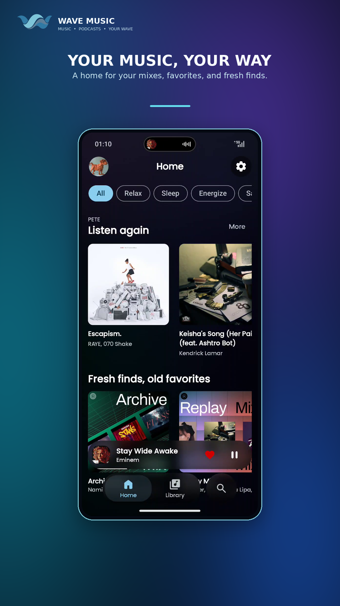
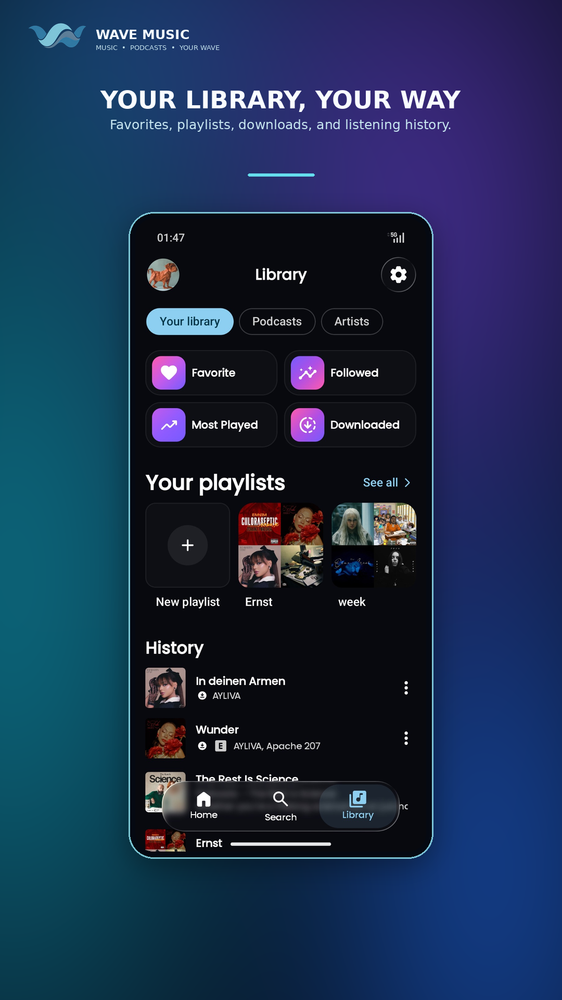
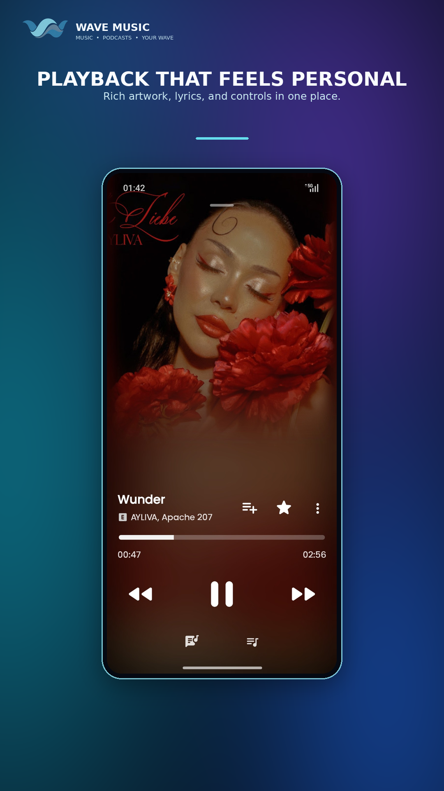
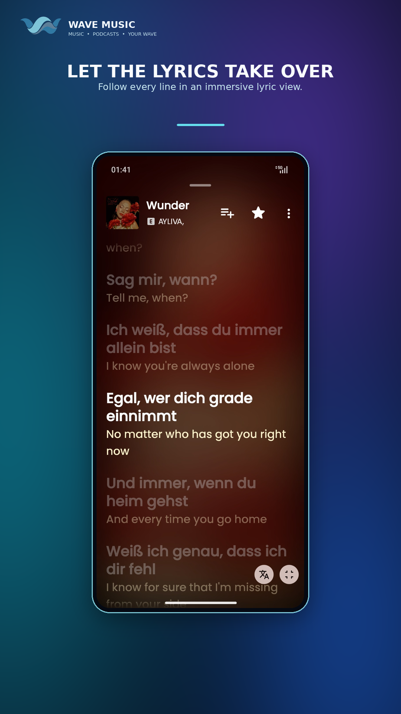
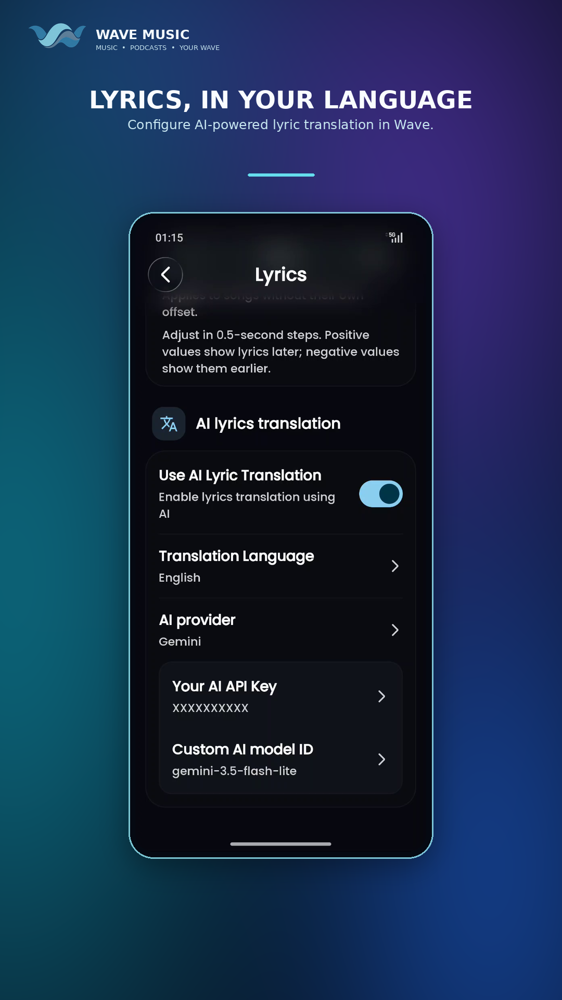
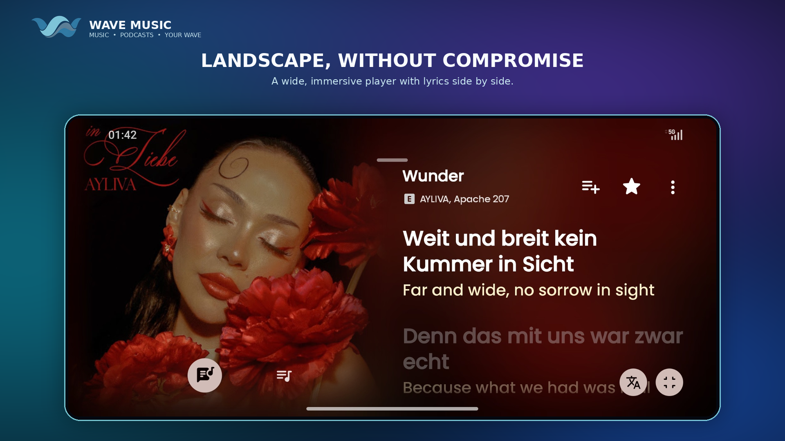
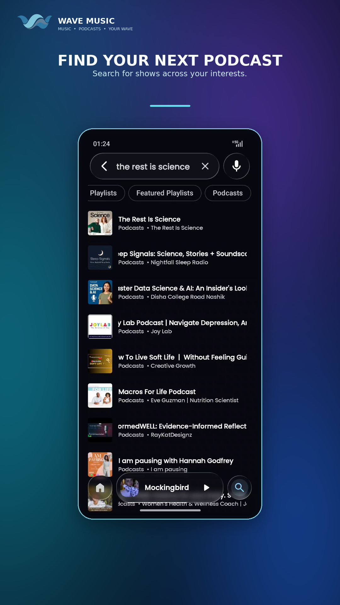
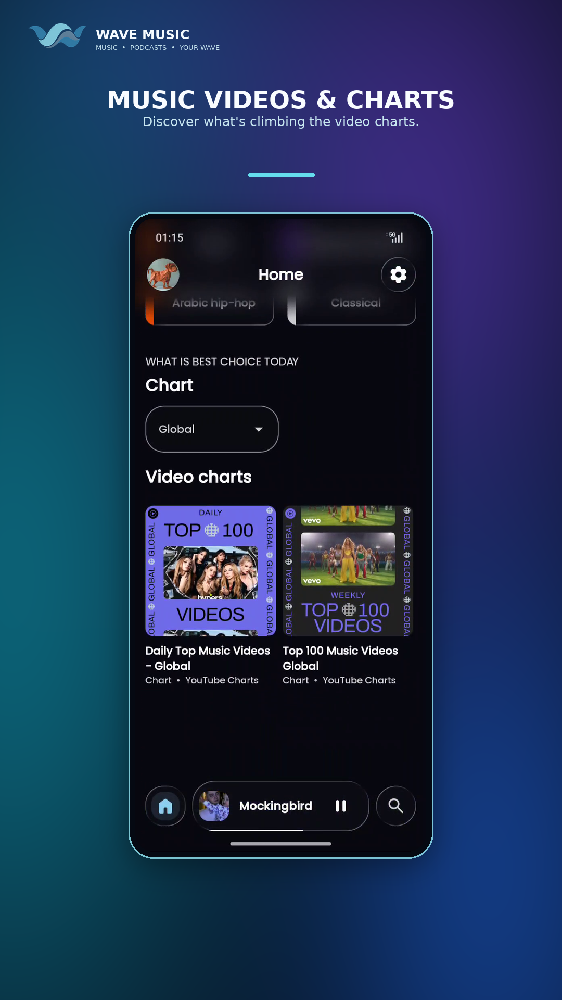

Copy this section into your repository's README.md after uploading the `docs/` folder.

## Screenshots

  
  
  

  
  
  

  
  
  

To use the peach-gradient version instead, change each image path to `docs/screenshots/peach/<filename>.png`.
