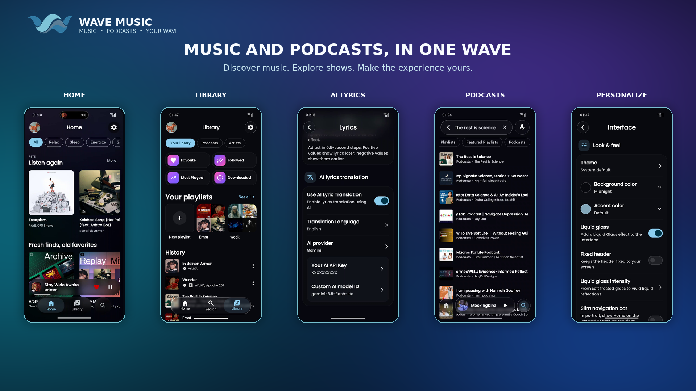
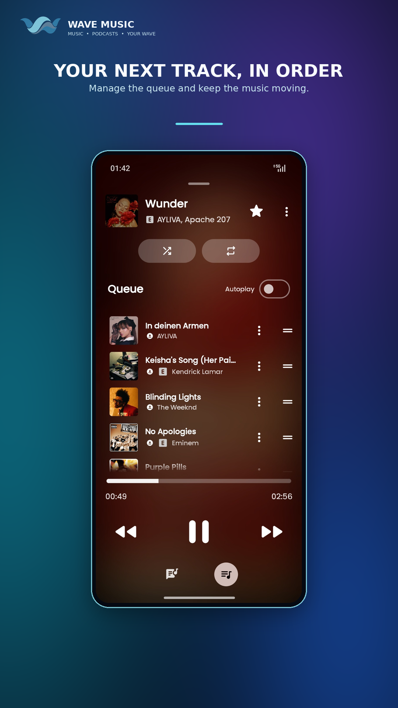
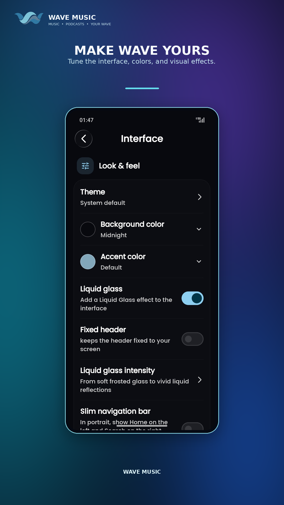

# Wave Music

**Music, podcasts, and your own listening experience — in one place.**

A modern music app focused on discovery, a personal library, synchronized lyrics, and a customizable interface.

  
  
  

---

## About

Wave Music is a music and podcast app designed to make listening feel personal. Browse and discover music, keep your library organized, follow lyrics, tune in to your favorite podcasts, and tweak the interface to your taste.

The project is built with Kotlin and Compose Multiplatform.

## Features

- **Personal library**: Keep your favorites, playlists, listening history, and saved content organized.
- **Now playing and queue**: Control playback and manage what plays next.
- **Synchronized lyrics**: Follow along with lyrics while listening.
- **AI lyrics translation**: Translate lyrics using a configured AI provider and your preferred language.
- **Podcasts**: Discover shows, view show details, and browse episodes.
- **Music videos**: Explore music-video content.
- **Landscape player**: A dedicated player layout for landscape listening.
- **Interface customization**: Adjust colors, appearance, and visual effects, including liquid glass.
- **Personalization settings**: Customize the app to suit your preferences.

*Some features may vary between builds or depend on external services and API providers.*

## Screenshots

  
  
  

  
  
  

  
  
  

  

## Technology

- Kotlin
- Compose Multiplatform
- Gradle

## Credits and acknowledgments

Music Wave is made possible by the work of many open-source projects and communities:

Metrolist by Mostafa Alagamy for the base framework.

SimpMusic by maxrave-dev for the lyrics API provider.

BetterLyrics for word-by-word lyrics, unison, KuGou, LRCLIB. and artwork provider support.

Material Color Utilities

These acknowledgments do not imply affiliation with, endorsement by, or sponsorship from these projects. Their names and original work belong to their respective authors and contributors.

## Disclaimer

Wave Music is an independent project and is not affiliated with, endorsed by, or sponsored by YouTube, Google. Any third-party services and content remain subject to their respective terms, policies, and rights.

## License

Check the repository's `LICENSE` file for the applicable license.
